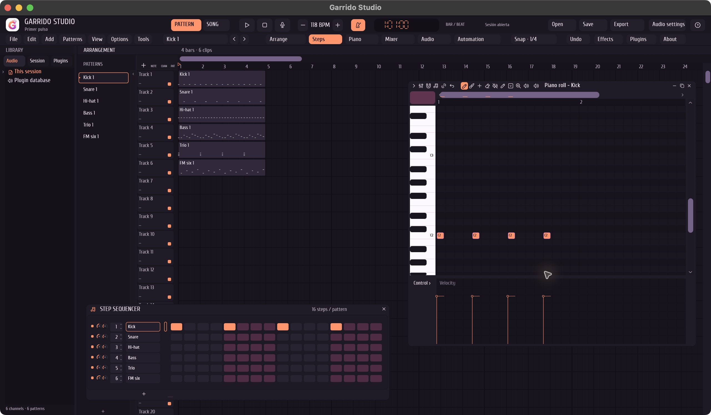

<div align="center">
  
  <h1>Garrido Studio</h1>
  <p>A desktop audio workstation written in Rust.<br>Original engine, instruments, effects and audio codecs.</p>
  <p>By <strong>Pelayo Garrido Martínez</strong></p>
  <p><a href="https://github.com/PelayoGarrido/Garrido-Studio/releases/tag/v1.1.0">Download v1.1.0</a> · <a href="https://PelayoGarrido.github.io/Garrido-Studio/">Website</a> · <a href="CONTRIBUTING.md">Contribute</a> · <a href="docs/ARCHITECTURE.md">Architecture</a></p>
</div>



Garrido Studio brings pattern sequencing, a piano roll, an audio playlist and a mixer into one native desktop workspace. Its Rust engine and DSP are implemented in this repository. Windowing, graphics, audio devices and file dialogs use pinned libraries.

Everything runs locally. No account, subscription, model download, telemetry or cloud service is needed. The application starts in dark mode; light mode is an explicit preference. The coral, rose and violet identity follows the official logo and the [approved moodboard](docs/BRAND.md).

## Download

| System | Package |
|---|---|
| macOS 13+, Apple Silicon | [macOS arm64](https://github.com/PelayoGarrido/Garrido-Studio/releases/download/v1.1.0/Garrido-Studio-1.1.0-macOS-arm64.zip) |
| Windows x64 | [Windows x64](https://github.com/PelayoGarrido/Garrido-Studio/releases/download/v1.1.0/Garrido-Studio-1.1.0-Windows-x64.zip) |
| Linux x86_64, glibc 2.39 | [Linux x64](https://github.com/PelayoGarrido/Garrido-Studio/releases/download/v1.1.0/Garrido-Studio-1.1.0-Linux-x64.tar.gz) |

Extract the entire package and open Garrido Studio. Keep its Resources and Plugins folders together. An example session and the license notices are included. [SHA256SUMS.txt](https://github.com/PelayoGarrido/Garrido-Studio/releases/download/v1.1.0/SHA256SUMS.txt) identifies the release files.

Linux requires ALSA and a graphical X11/Wayland desktop. macOS uses an ad-hoc signature; Developer ID/notarization and Windows publisher signing are future distribution work. If the operating system blocks opening a package, retain the exact message rather than disabling protection.

## Make music

- **Sequence:** shared multichannel patterns, step editing, swing, a channel rack and a piano roll with selection, ghost notes, velocity, snap, clipboard, quantize, transpose, legato, humanize, chop, strum, arpeggiation and flam.
- **Arrange:** repeating patterns and direct audio clips, waveform display, move/resize, phase-preserving audio cuts and compatible joins, groups, mute, trim and independent playlist rows.
- **Mix:** gain, pan, mute/solo, acyclic routing, post-fader sends, polarity, stereo swap and editable original effects. Graphical gain/pan/master automation uses four curve types.
- **Play:** original sampler, drums, bass, Trio and six-operator FM. Playback uses a worker and a fixed 8,192-frame queue; the audio callback takes no locks and allocates no queue storage.
- **Record:** explicit input-device and channel selection, one pair or all pairs from up to 32 input channels. Private float32 WAV originals are written by one disk worker, with header checkpoints and recovery. There is no input monitoring.
- **Edit and export:** WAV, FLAC and AIFF/AIFF-C input; waveform transforms; WAV PCM16/24/float32, FLAC PCM16/24 and AIFF PCM16/24 output; mix/channel/pattern scopes and aligned channel stems with effects and sends.
- **Keep your work:** checked `.gstudio` sessions with embedded samples, named undo history, save-copy, recovery snapshots, persistent device/theme preferences and recent files. Existing music files are not replaced.

The included CLAP module exports eight effects and six instruments backed by the same DSP. The app can scan and render these in separate bounded worker processes. `Check-Plugins` runs the included-module diagnostic without opening speakers or a microphone.

FLP interoperability preserves opaque source data and supports selected notes, tempo and uncropped pattern playlists. Unsupported edited exports are refused. MIDI files support notes, sustain, tempo maps and markers. See [Contributions and compatibility](CONTRIBUTING.md) for the current boundaries and the next areas of development.

To start, open the included example with FILE → Open, select a channel, add or move notes, then press Space to play. Select an output in OPTIONS → Audio settings if needed. Command on macOS / Ctrl elsewhere: O opens, S saves a new copy, Z undoes and Shift+Z redoes. F5/F6/F7/F9 show playlist/rack/piano/mixer.

## Build

Use the pinned Rust toolchain, Python 3.11+ and pnpm. macOS needs Xcode Command Line Tools; Windows needs MSVC build tools; Linux needs ALSA, Wayland and xkbcommon development libraries plus pkg-config.

```sh
pnpm desktop:fetch
pnpm check
pnpm desktop:check
pnpm build
pnpm desktop:build
pnpm desktop:bundle --release --check-plugins
```

The root audio workspace has no registry dependencies. The desktop uses pinned eframe/egui, CPAL, rfd and fs4. Builds use at most two jobs, one for local cross builds. Fresh desktop/cross builds require 5 GiB free; cached `--reuse` builds require 3.5 GiB and stop below a 3 GiB reserve. See [platforms](docs/PLATFORMS.md) and [dependencies](docs/DEPENDENCIES.md).

[Validation](docs/VALIDATION.md), [security boundaries](docs/SECURITY.md), [feature matrix](docs/PARITY.md) and [third-party notices](THIRD-PARTY-NOTICES.md) document the implementation and its evidence. Contribution checks include corruption/resource-limit cases, allocation instrumentation, headless editor tests and native included-plugin diagnostics.

## License

[PolyForm Noncommercial 1.0.0](LICENSE), with an explicit [commercial music permission](COMMERCIAL-MUSIC-PERMISSION.md). You may produce and sell music/audio using Garrido Studio. Selling or monetizing the software, a fork or a hosted software service requires separate permission from Pelayo Garrido Martínez.

This is source-available software. Third-party libraries and assets retain their own licenses. No Lemon Studio engine, source code or repository artwork is incorporated; the independently drawn workspace was informed by its public screenshots. See [legal provenance](docs/LEGAL.md).

## Development note

AI tools assisted coding and documentation. Tests, provenance, third-party notices and current limitations are documented in this repository.
