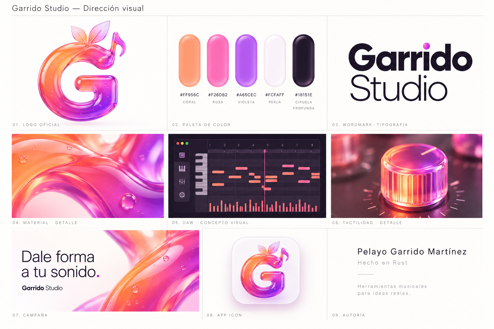

# Garrido Studio · identidad visual

El logo oficial es la imagen entregada por Pelayo. El moodboard fue aprobado el 28 de octubre de 2026 y queda fijado: no se regenera, retoca ni sustituye sin una nueva instrucción.

## Archivos maestros

- `assets/brand/logo-official.jpeg`: original intacto, 2048 × 2048.
- `assets/brand/moodboard-approved.png`: dirección visual aprobada; es una composición conceptual, no una captura de la aplicación.
- `assets/brand/provenance.json` y `SHA256SUMS`: procedencia, decisiones y huellas.
- PNG, RGBA e ICO: derivados técnicos del original para los iconos. Conservan su fondo blanco y su silueta. No son rediseños.

La G une fruta, hojas y nota musical. El material es vidrio translúcido, con reflejos suaves y una transición coral, rosa y violeta. No se sustituyen la silueta, las hojas o la nota por aproximaciones geométricas.

## Paleta

| Color | Valor | Uso |
|---|---|---|
| Coral | `#FF956C` | Controles activos, notas y señales de interacción |
| Rosa | `#F26DB2` | Selección, énfasis y composición de marca |
| Violeta | `#A65CEC` | Contornos, profundidad y detalles secundarios |
| Perla | `#FCFAFF` | Material de presentación, teclas y superficies claras |
| Ciruela | `#18151E` | Fondo del estudio, texto sobre coral y contraste |

## Aplicación

El estudio arranca siempre en modo oscuro por defecto. No sigue automáticamente el tema claro del sistema operativo. El usuario puede activar el modo claro desde OPTIONS → Light theme y volver con Dark theme. El cambio visual no modifica la música, el historial ni los archivos. La elección se guarda como preferencia explícita entre arranques.

Se conserva la estructura de trabajo de referencia: transporte, navegador, selector, arreglo y editores flotantes. La paleta y el logo aprobados sustituyen la identidad amarilla anterior. El plano de trabajo permanece sobrio y legible: los reflejos y el vidrio tienen más presencia en la marca y las presentaciones que en las rejillas de edición.

La tipografía de interfaz sigue siendo Cuprum, con su licencia OFL incluida. El wordmark ilustrado en el moodboard es una dirección tipográfica; no se presenta como una fuente adicional adquirida o incorporada.

## Presentación y marketing

Fondos blancos o perla, espacio amplio, tipografía ciruela y acentos coral, rosa y violeta. Usar el logo oficial o sus derivados aprobados. El lema del moodboard es «Dale forma a tu sonido.» y la autoría del software es «Pelayo Garrido Martínez».

Las capturas del producto deben proceder de la aplicación real. El moodboard no demuestra funciones terminadas ni disponibilidad en Windows/Linux. Las piezas de lanzamiento no deben anunciar descarga, latencia, compatibilidad de plugins, grabación o paridad completa hasta que exista evidencia.

La designación del logo como oficial procede del usuario. Este registro conserva esa decisión y no sustituye una revisión de derechos o de marcas.

## Espacio de trabajo 1.1

La revisión 1.1 usa controles de ventana nativos, una cabecera con la marca a la izquierda, transporte agrupado y vistas con nombre. La biblioteca muestra tres pestañas funcionales y el secuenciador usa celdas proporcionales al ancho de su panel. Los registros de la comparación inicial se conservan como historia del proyecto. Estos cambios no constituyen una certificación jurídica.
