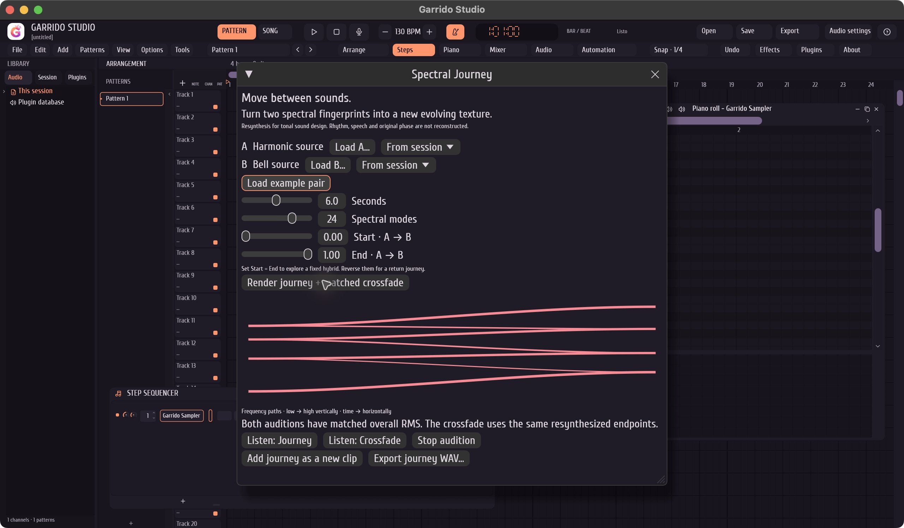

# Spectral Journey

Build a new sound by moving between the spectral fingerprints of two short sources. A bell can gradually become a harmonic chord; a fixed position creates an intermediate texture. The frequency components travel through pitch space. A crossfade retains the two endpoint spectra and changes their volumes.

This is tonal resynthesis, with its own phase and envelope. It does not preserve speech, transients, rhythm, original phase or the full recording. It is intended for transitions, drones, risers and sound design. It is not a restoration, mastering, source-separation or general audio-morphing claim.

## In the application



1. Open **Tools → Spectral Journey**.
2. Load two WAV, FLAC or AIFF sources, use the selected sample channel, or choose **Load example pair**.
3. Set duration and mode count. Start = 0 / End = 1 travels from A to B. Reverse these for B to A. Equal values hold a fixed hybrid.
4. Render and inspect the frequency paths. Audition **Journey** and **Crossfade**; they have matched overall RMS and are independently started by the user. Stop audition before changing sources.
5. Add the journey as a new audio clip at the arrangement cursor/lane, or export a new WAV. Existing source files and channels remain available. Insertion is one named undo transaction.

Inputs are immutable snapshots. A completed result cannot be inserted after the session revision changes. A failed insertion retains the render for export. The input device is never opened by this feature. Audition opens the selected output only after pressing Listen.

## Signal path

The Rust implementation lives in `src/spectral.rs`; the shared desktop integration is `apps/desktop/src/spectral_ui.rs`. There are no new registry dependencies, trained weights or network calls.

Analysis removes the channel DC mean and averages up to 32 Hann-windowed FFT power spectra. A radix-2 complex FFT is implemented in this repository. The window grows with sample rate, from 1,024 to 8,192 samples. Local maxima use quadratic interpolation of log power for sub-bin frequency estimates. The strongest 1–32 peaks above a relative threshold form a sorted modal fingerprint, with normalized spectral power and left/right energy balance.

The two normalized modal distributions are coupled by their cumulative masses. The monotone one-dimensional transport plan has at most `m + n - 1` routes and takes linear time after sorting. This conservation describes the spectral coupling; it is not a guarantee of waveform power under interference between oscillators.

Each route follows a smoothstep time curve between the configured start and end. Frequencies interpolate in log Hz, so the middle of a 220 → 880 Hz route is 440 Hz. Additive oscillators keep continuous accumulated phase during the journey. Channel energy balance follows the same progression. A ten-millisecond boundary fade avoids a discontinuous start/stop. Output level is bounded with a shared stereo gain; this is a sample-peak bound, not a true-peak or acoustic safety certification.

The comparison uses two resynthesized endpoint fingerprints, not untreated original recordings. Their conventional crossfade follows the same duration and time curve. Both completed renders are attenuated to the lower overall RMS; neither is boosted for the comparison. Overall RMS matching is not perceptual loudness matching and does not equalize every moment of the transition.

Analysis, synthesis and comparison run on a cancellable worker. The audio callback does none of that work. Work and storage are explicitly bounded; cancellation is checked during analysis and synthesis. The preview graph shows the actual transport routes returned by the worker, not a decorative animation.

## Limits

| Item | Bound |
| --- | --- |
| Input file | Normal local file, up to 24 MiB; existing checked decoders |
| Input duration | 128 frames to 12 seconds per source |
| Input/output sample rate | 8–192 kHz |
| Fingerprint | 1–32 tonal modes per source |
| Render | 0.25–12 seconds; maximum 2,304,000 stereo frames |
| Bandwidth | Modes below 20 Hz or at/above 45% of the source rate excluded |
| Output bandwidth | Rejects a target rate that cannot represent the selected modes |
| Session insertion | Existing channel, sample-memory and arrangement limits |

Dense noise, drums, voice and changing melodies may become a sparse, synthetic texture. A short tonal excerpt gives more predictable fingerprints. At high rates the largest possible render and 63-route plan take more work than the small included example. Rendered phase is deterministic within an implementation/platform; cross-platform bit identity is not promised.

## Reproduce the comparison

```sh
pnpm check
pnpm desktop:check --release
pnpm spectral:demo --out outputs/my-spectral-demo
```

Use an empty output folder. The generator writes the two matched WAV renders, their actual route data, timing/RMS metadata and an example session. The comparison channel is muted in that session; use solo/mute to compare one at a time. No loudspeaker or microphone is opened by the generator. The generated harmonic inputs belong to this project.

The CLI also accepts local sources:

```sh
pnpm exec cargo run --offline --locked --release -- spectral-journey A.wav B.wav Journey.wav 6
pnpm exec cargo run --offline --locked --release -- spectral-journey A.wav B.wav Hybrid.wav 6 0.5 0.5
```

The CLI writes a new PCM24 WAV and refuses to replace an existing file. Its default output rate is 48 kHz.

Regression checks compare the FFT with a direct DFT, measure the 220/880 → 440 Hz midpoint, verify transport mass/order, stereo movement, deterministic synthesis, matched comparison levels, cancellation, invalid values, DC/silence, alias-risk rejection and session save/undo behavior. These checks are bounded engineering evidence; they do not establish subjective musical acceptance on arbitrary recordings.

## Research and prior work

Spectral morphing and optimal transport are established ideas. This implementation is written independently for Garrido Studio; it does not incorporate research or commercial product code. It is not a world-first claim or a reproduction of the full algorithms below.

- Trevor Henderson and Justin Solomon, [Audio Transport: A Generalized Portamento via Optimal Transport](https://arxiv.org/abs/1906.06763), DAFx 2019.
- Gerard Roma, Owen Green and Pierre Alexandre Tremblay, [Audio Morphing Using Matrix Decomposition and Optimal Transport](https://dafx.de/paper-archive/details/fFyCdHIafOZAOEKeavTSyw), DAFx 2020. Their NMF/HPSS system is distinct from this modal-fingerprint implementation.
- [Zynaptiq MORPH 3](https://zynaptiq.com/morph/what-s-new-in-morph-version-3/) already offers audio morphing and transient controls.
- [Bitwig Spectral Suite](https://www.bitwig.com/spectral-suite/) already provides native spectral processing.
